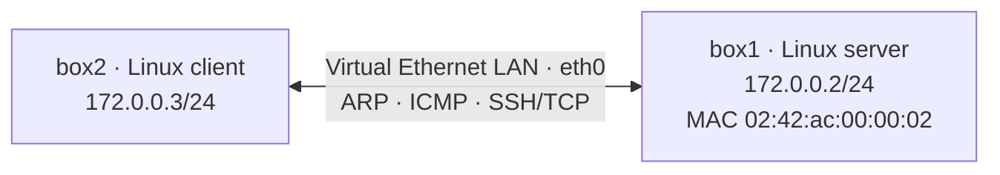

# Network Traffic Analysis: ARP, ICMP and SSH/TCP

**Focus:** Networking · TCP/IP · packet inspection · Linux · SSH  
**Course context:** CSCI 412 (Information Security), John Jay College of Criminal Justice  
**Status:** Coursework completed; observations recorded. **Original packet screenshots and PCAP files have not yet been recovered.**

## Goal
Understand how two Linux systems communicate on a local network: ARP resolves IP addresses to MAC addresses, ICMP tests reachability, and TCP establishes a connection before SSH traffic begins.

## Lab setup and network diagram
The course's `network-basics` Labtainer exercise uses two virtual Linux hosts sharing a virtual Ethernet network.

The subnet, names, and MAC belong to a **virtual lab**. `box2`'s source TCP port was recorded as 51392 in the coursework; the SSH destination port was 22.

## Tools used
- Ubuntu/Linux in the Labtainer framework
- `ip addr`, `arp -a`, `ping`, `ssh`
- `tcpdump` to observe network traffic
- Protocol knowledge: Ethernet, ARP, ICMP, TCP three-way handshake
- [Optional *new* portfolio helper](tools/packet_summary.py) to summarize an exported Wireshark/tshark TSV; **this helper was added while preparing the portfolio, not part of the original lab**.

## Completed lab steps
1. Inspected host interfaces, IP addresses, and Ethernet MAC addresses.
2. Used ARP-table inspection to examine address resolution between the two virtual hosts.
3. Used `tcpdump` while sending ping traffic to observe address resolution and ICMP communication.
4. Initiated an SSH connection from the client and analyzed the TCP handshake traffic.
5. Identified TCP source/destination ports and sequence information in the captured packets.

## Recorded results (from the coursework)
- `box1` IPv4 address: **172.0.0.2**
- `box2` IPv4 address: **172.0.0.3**
- `box1` MAC: **02:42:ac:00:00:02**
- TCP destination service: **SSH / 22**
- Example observed ephemeral source port: **51392**
- Recorded raw TCP SYN/ACK sequence number: **1234349283**
- The exercise's completion check (`checkwork`) passed and required a `.lab` submission.

These values are **transcribed from the prior coursework notes**; a source packet capture or screenshot should be added before presenting them as independently re-checkable evidence.

## Evidence status / screenshot plan
Original `tcpdump` screenshots and the captured `.pcap`/`.lab` files were not present in the recovered portfolio source files. **No sample packets or synthetic screenshots are being passed off as real measurements.**

Add authentic captures to [`evidence/`](evidence/README.md):
- ARP request/reply plus ICMP ping sequence
- `arp -a` before/after address resolution
- TCP SYN, SYN/ACK, ACK with packet detail pane visible
- An original `tcpdump` terminal screenshot or redacted PCAP

## Reproduce safely in a course lab
Refer to [`scripts/capture-lab-traffic.sh`](scripts/capture-lab-traffic.sh) for **newly written** helper commands. Run only within the same disposable, authorized two-host lab; do not record production credentials or unrelated network traffic.

## What I would improve
- Export original, filtered PCAP files and Wireshark screenshots with labeled protocol fields.
- Create a table connecting each TCP flag and IP/MAC observation to one specific packet number.
- Add a short discussion of why ARP trust creates spoofing risk, without claiming I performed an ARP-spoofing attack in this project.
- Compare packet output captured with `tcpdump` vs. Wireshark and document any interpretation differences.

## Provenance
The lab steps and recorded values come from my CSCI 412 work. The two-host design comes from the course's `network-basics` Labtainer manual. The Python and shell helpers were authored **later for portfolio reproducibility** and are not represented as original class submissions.
