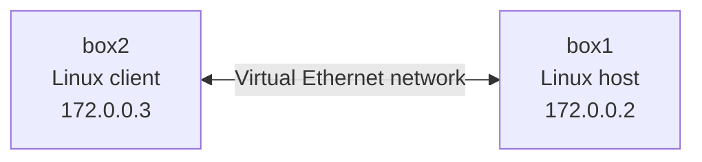

# ARP and TCP Traffic Analysis

Networking study notes and a packet-summary utility based on **CSCI 412: Information Security** coursework at John Jay College of Criminal Justice.

## Objective

Observe how two Linux hosts communicate on a local network: ARP associates IP and MAC addresses, ICMP tests reachability, and a TCP three-way handshake establishes a connection before SSH.

## Lab network

The course used an isolated Labtainer environment.

## Tools and workflow

- `ip addr` — inspect interfaces and addresses
- `arp -a` — inspect IP-to-MAC mappings
- `ping` — generate ICMP echo requests and replies
- `tcpdump` — inspect ARP, ICMP, and TCP traffic
- `ssh` — initiate TCP traffic to port 22

The exercise examined ARP request/reply behavior and the TCP SYN → SYN/ACK → ACK handshake. In the recorded coursework notes, box1 was `172.0.0.2`, box2 was `172.0.0.3`, and SSH used destination port 22.

## Packet analysis utility

[`tools/packet_summary.py`](tools/packet_summary.py) is a small Python program created after the class exercise. It summarizes protocol counts, destination TCP ports, and TCP flag values from a TSV exported using `tshark`.

This utility is supplementary code; it is **not** an original packet capture or a claim that the original lab was automated.

## Evidence

The original packet-capture file and terminal screenshots are not currently included in this repository. Accordingly, this is a documented protocol exercise and helper tool, **not yet a packet-capture case study**. A capture showing the actual ARP exchange and TCP handshake would make the analysis independently reproducible.

## Next improvements

- Export the original Labtainer capture, or rerun the isolated exercise and save a fresh `.pcap`.
- Identify a specific ARP request/reply and TCP SYN/SYN-ACK/ACK by frame number.
- Add a short annotated packet table and two genuine Wireshark or terminal screenshots.

The IP addresses refer only to the classroom lab.
